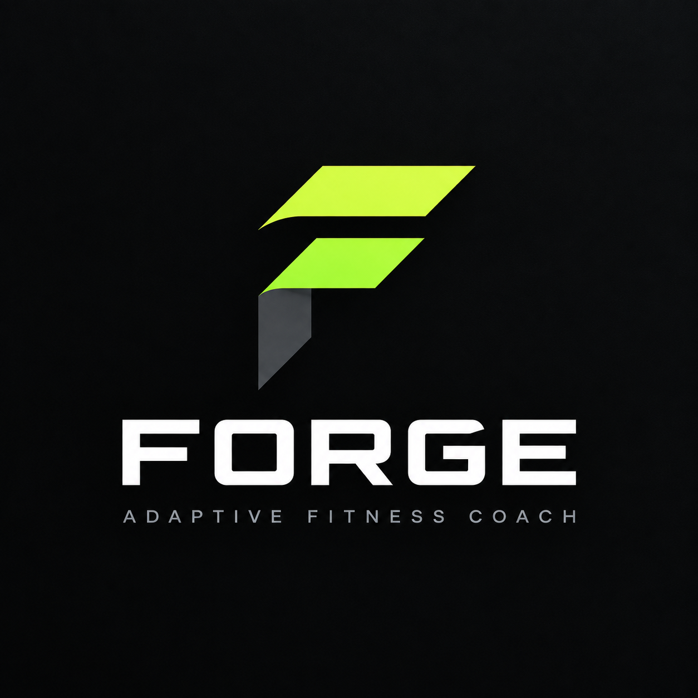
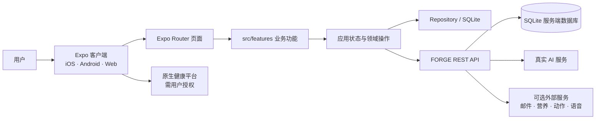

<div align="center">



# FORGE

### Adaptive Fitness Coach · 训练、恢复与饮食，一个可执行的系统

[线上体验](https://forge.iamwudi.ltd) · [功能验收记录](./docs/FORGE_FUNCTIONAL_TEST_REPORT_2026-09-16.md) · [UI/UX 优化路线图](./docs/FORGE_UIUX_OPTIMIZATION_ROADMAP.md)

**FORGE 是一款面向个人力量训练者的训练与营养管理应用。**它将训练计划、训练执行、身体状态、饮食记录与 AI 教练放入同一套个人数据系统，让建议能够转化为经过确认、可追踪、可回顾的实际行动。

</div>

> **项目状态：持续开发中 · 私有仓库 · 当前版本 0.1.0**  
> 仓库包含客户端、API 服务、设计规范与产品文档。部分外部能力需要部署者配置真实服务；未配置时会明确显示不可用，不以虚构数据或假成功状态代替。

## 目录

- [项目愿景](#项目愿景)
- [核心能力](#核心能力)
- [典型工作流](#典型工作流)
- [架构概览](#架构概览)
- [技术栈](#技术栈)
- [快速开始](#快速开始)
- [配置说明](#配置说明)
- [常用命令](#常用命令)
- [代码目录](#代码目录)
- [数据与安全](#数据与安全)
- [平台与集成边界](#平台与集成边界)
- [项目文档](#项目文档)
- [开发协作与许可](#开发协作与许可)

## 项目愿景

训练应用经常把训练、营养、恢复和记录割裂成不同工具，用户需要手工搬运数据，也难以确认建议是否真正改变了计划。FORGE 的目标是建立一个连续闭环：

1. 记录目标、训练计划、训练执行、饮食和恢复状态。
2. 在用户授权范围内，为 Coach 提供完成任务所需的个人上下文。
3. 将 AI 建议转换为受限、可检查的操作，而不是让模型任意改库。
4. 用户确认后才写入系统，并由相关页面读取更新后的数据。
5. 保留历史记录，让计划和实际执行可以复盘。

FORGE 面向日常力量训练与营养规划，不是医疗诊断、治疗或康复工具。

## 核心能力

### 账号与个人资料
- 注册、登录、会话刷新与退出登录。
- 管理目标、身体信息、训练偏好与 Coach 数据授权。
- 多因素认证、恢复码、会话管理和安全审计相关流程。
- 账号数据导出、隐私管理与反馈入口。

密码重置和邮箱验证依赖真实邮件投递服务；未完成配置时，不应显示“邮件已送达”。

### 今日与训练
- 今日页汇总当天训练、身体状态和营养信息。
- 创建、查看和调整训练计划。
- 训练中记录动作、组数、次数与重量，生成训练总结并查看历史。
- 根据真实记录呈现训练进展，不用预填的虚构趋势填充页面。

### 营养与食物池
- 记录当天营养摄入和逐餐数据。
- 维护个人食物池，表达用户现实中能获得、愿意选择的食物。
- 保存食物营养信息与常用份量，辅助后续饮食规划。
- 配置外部营养数据源后查询真实信息；用户应核对影响规划的营养值和份量。

### AI Coach
- 客户端通过 FORGE API 服务端代理访问已配置的真实模型供应商。
- 在用户授权后，可结合目标、训练计划、准备度、睡眠/疲劳/酸痛、营养摄入和食物池摘要生成回答。
- 支持对话历史和按日组织的新会话，降低单个会话无限累积上下文的负担。
- 对可能改变系统数据的建议使用受限操作；客户端校验并要求用户确认后才应用。
- 模型或网络失败时显示实际错误并提供重试/取消，不以本地编造回复代替。

模型供应商、模型名称和 API Key 由服务端管理，不能写入客户端源码或 Expo 公开环境变量。

### 进展、健康与提醒
- 根据真实训练和身体记录展示变化与趋势。
- 原生平台可按权限连接 Apple HealthKit 或 Android Health Connect。
- 通知能力取决于平台、设备授权和构建配置。

空数据代表尚无足够记录，不代表存在隐藏的模拟数据。Web 浏览器不提供原生健康平台权限。

## 典型工作流

以 Coach 辅助调整训练或饮食为例：

1. 用户描述目标、限制或希望调整的内容。
2. API 调用已配置的真实模型，返回回答和受限的操作意图。
3. 应用校验操作类型与参数，并展示将发生的变更。
4. 用户确认后，应用才写入计划或个人数据。
5. 今日、训练、营养和资料页面读取更新后的应用数据。
6. 请求、写入或同步失败时保留失败状态，不把“已发送”冒充“已保存”。

## 架构概览



路由在 `app/`；页面与功能在 `src/features/`；共享组件和设计 Token 在 `src/design-system/`；数据服务和 Repository 在 `src/data/`；API 与 Web 静态服务分别在 `server/index.mjs` 和 `server/web.mjs`。服务端使用 Node.js 内置 SQLite 接口。

## 技术栈

| 层次 | 技术 |
| --- | --- |
| 客户端 | React Native、React、Expo SDK、Expo Router |
| 语言 | TypeScript、JavaScript ES Modules |
| 本地与设备集成 | Expo SQLite、Expo Notifications、HealthKit / Health Connect 适配 |
| API 与数据库 | Node.js 22.5+、`node:sqlite`、HTTP REST |
| Web 静态服务 | Node.js HTTP Server |
| 包管理 | pnpm（版本见 `package.json`） |

## 快速开始

### 环境要求
- Node.js **22.5+**（API 使用内置 SQLite）。
- pnpm **10.x**，建议使用 `package.json` 声明的版本。
- iOS Simulator、Android Emulator 或真实设备；原生功能需要相应 SDK。
- Coach、邮件、语音或外部目录需要部署者配置真实服务和凭据。

### 安装并运行客户端

```bash
git clone https://github.com/iostreamwudi/FORGE.git
cd FORGE
pnpm install --frozen-lockfile
cp .env.example .env.local
```

在 `.env.local` 中设置客户端可访问的 API 地址：

```dotenv
EXPO_PUBLIC_FORGE_API_URL=https://your-forge-api.example.com
EXPO_PUBLIC_COACH_AI_TIMEOUT_MS=30000
```

启动 Expo 或 Web 预览：

```bash
pnpm start
# 或
pnpm exec expo start --web
```

终端可按提示打开 iOS / Android 模拟器，或连接兼容的原生开发客户端。

### 启动 API

`.env.api.example` 是不含生产凭据的服务端模板。复制到受保护的私有环境，并配置安全随机的 `FORGE_SESSION_SECRET`：

```bash
cp .env.api.example .env.api
set -a
. ./.env.api
set +a
pnpm api
```

生产环境还应设置 HTTPS `FORGE_PUBLIC_BASE_URL`、受限 CORS 来源、持久化数据库目录及所需模型配置。生产密钥应由 systemd、容器或其他进程管理器安全注入。不要把真实环境文件放到静态 Web 根目录。

本地健康检查：

```bash
curl http://127.0.0.1:8787/healthz
```

## 配置说明

### 客户端
| 变量 | 说明 |
| --- | --- |
| `EXPO_PUBLIC_FORGE_API_URL` | 客户端连接的 FORGE API 地址 |
| `EXPO_PUBLIC_COACH_AI_TIMEOUT_MS` | Coach 请求超时上限 |

`EXPO_PUBLIC_*` 会进入客户端构建产物，只能放公开值。**禁止放入 API Key、会话密钥、Webhook 密钥或私钥。**

### 服务端
完整配置清单见 [`.env.api.example`](./.env.api.example)，主要包括 API 端口、CORS 来源、公开 HTTPS 地址、数据库/导出目录、`FORGE_SESSION_SECRET`、AI 模型供应商配置，以及可选的营养、动作目录、邮件、语音和运维指标服务配置。可选服务未配置时应明确不可用，不使用假目录、假账号或假回复代替。

## 常用命令

| 命令 | 说明 |
| --- | --- |
| `pnpm start` | 启动 Expo 开发服务器 |
| `pnpm exec expo start --web` | 启动 Web 开发预览 |
| `pnpm ios` | 启动 iOS 模拟器（需 Xcode） |
| `pnpm android` | 启动 Android 模拟器（需 Android SDK） |
| `pnpm api` | 启动 API（须注入服务端环境变量） |
| `pnpm typecheck` | TypeScript 静态检查 |
| `pnpm lint` | Expo ESLint 检查 |

## 代码目录

```text
.
├── app/                    # Expo Router 路由
├── assets/                 # 品牌与应用资源
├── design-system/          # 设计规范与页面说明
├── docs/                   # API、AI 接入、验收与产品计划
├── server/
│   ├── index.mjs           # REST API、鉴权与服务端业务
│   └── web.mjs             # Web 静态服务与缓存策略
├── src/
│   ├── data/                # API、SQLite 与 Repository
│   ├── design-system/       # 组件与设计 Token
│   ├── features/            # 账号、Coach、训练、营养、进展等
│   ├── state/               # 应用状态和跨模块更新
│   ├── types/               # 领域模型
│   └── utils/               # 通用工具
├── .env.example             # 客户端环境模板
└── .env.api.example         # 服务端环境模板
```

## 数据与安全

- SQLite 文件位置由 `FORGE_DB_PATH` 控制；生产数据库和备份不属于源码仓库。
- Git 忽略私有环境文件、`.data/`、日志、`node_modules/` 和构建输出。
- 生产环境应使用 HTTPS、强随机会话密钥、受限 CORS，并保护数据库和备份。
- Coach API Key 只放在 API 服务端；客户端不直接连接模型供应商。
- Coach 上下文遵循用户授权；改变训练或饮食数据前须经过操作校验和用户确认。
- 账号功能包含数据导出/删除、会话管理和安全审计流程。
- 不要将生产数据、用户导出、令牌、密钥、私钥或日志提交到仓库或公开工单。

FORGE 提供一般训练与营养规划，不替代医疗诊断、治疗或专业康复意见。

## 平台与集成边界

| 能力 | 接入方式 | 运行条件 |
| --- | --- | --- |
| AI Coach | API 服务端代理到真实模型 | 配置供应商地址、模型与密钥 |
| 密码重置 / 邮箱验证 | 邮件 Webhook | 配置真实投递端点与密钥 |
| 食物营养查询 | 外部营养数据服务 | 配置数据源和凭据 |
| 训练动作目录 | 服务端目录接口 | 配置符合 API 契约的真实目录 |
| 语音转写 | 服务端转写接口 | 配置真实转写服务；平台能力不同 |
| HealthKit / Health Connect | 原生系统接口 | 原生构建、兼容设备和用户授权 |
| 系统通知 | Expo 与平台接口 | 正确构建、平台配置和设备授权 |

这些服务不会因克隆仓库而自动启用，需部署者配置。未配置时，应用应诚实呈现不可用状态。

## 项目文档

- [Coach AI 接入与安全边界](./docs/COACH_AI_INTEGRATION.md)
- [FORGE API 契约](./docs/FORGE_API_CONTRACT.md)
- [功能验收记录](./docs/FORGE_FUNCTIONAL_TEST_REPORT_2026-09-16.md)
- [实施计划](./docs/FORGE_IMPLEMENTATION_PLAN.md)
- [UI/UX 优化路线图](./docs/FORGE_UIUX_OPTIMIZATION_ROADMAP.md)
- [端到端设计说明](./docs/FORGE_C_END_DESIGN.md)
- [设计系统主规范](./design-system/forge/MASTER.md)
- [Coach 页面设计](./design-system/forge/pages/coach.md)
- [进展页面设计](./design-system/forge/pages/progress.md)

## 开发协作与许可

FORGE 当前是私有的持续开发项目。提交功能变更前建议运行：

```bash
pnpm typecheck
pnpm lint
```

涉及数据写入的改动，应验证登录/未登录、空数据、服务不可用、网络失败和权限拒绝。Coach 改动应覆盖“建议 → 参数校验 → 用户确认 → 数据写入 → 相关模块更新”完整流程，并同步更新文档。

当前没有独立贡献指南或 `LICENSE` 文件。许可证明确之前，不应认为仓库内容可以自由复制、分发或商用；请先与仓库所有者确认协作方式和授权。
